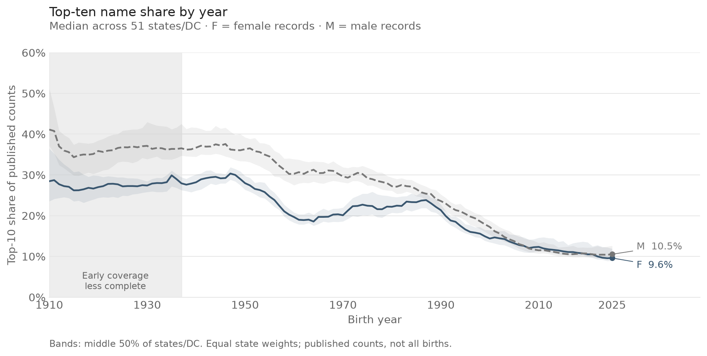
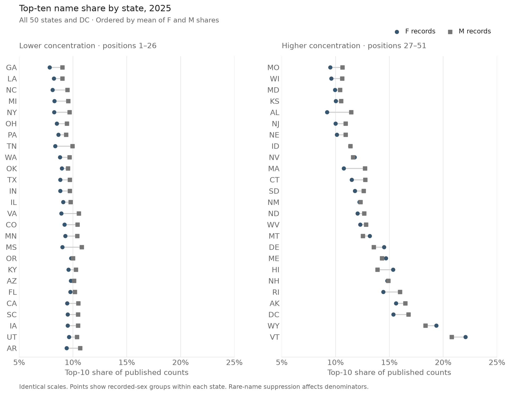
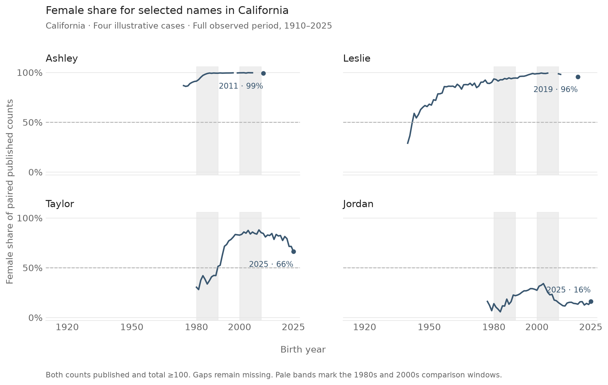

## Summary statistics

| Year | Sex | Published counts | Distinct names | Median top-10 share |
| --- | --- | --- | --- | --- |
| 1950 | F | 1,610,017 | 2,112 | 28.0% |
| 1950 | M | 1,720,112 | 1,721 | 36.3% |
| 1980 | F | 1,462,212 | 3,685 | 22.2% |
| 1980 | M | 1,668,069 | 2,502 | 27.2% |
| 2025 | F | 1,303,470 | 5,349 | 9.6% |
| 2025 | M | 1,466,284 | 4,368 | 10.5% |

Counts sum published records across states/DC. Distinct names are the union of spellings within each year and recorded-sex category. Concentration gives every state/DC equal weight.

## Concentration over time

For F records, the median state top-ten share was 28.0% in 1950 and 9.6% in 2025 (-18.4 percentage points). For M records, the median state top-ten share was 36.3% in 1950 and 10.5% in 2025 (-25.8 percentage points).

{#fig-concentration fig-alt="Female and male median top-10 shares across states over time, with interquartile bands and the less-complete early period shaded."}

Lower concentration is consistent with diversification among published records. It does not establish convergence in which names states prefer. Shares use published counts, not all births; suppression and incomplete early coverage limit comparisons.

## Differences between states

The 2025 top-10 shares span F: 7.8%–22.1%, from GA to VT; M: 9.0%–20.8%, from GA to VT.

{#fig-states fig-alt="Paired female and male top-10 shares for every state and DC, displayed in two ordered panels on identical percentage scales."}

Circles show F records; squares show M records. Suppression affects the published denominator, particularly in smaller states, so these differences are descriptive.

## Selected name–sex trajectories

Among these four selected examples, Taylor has the largest absolute difference between the comparison windows. Its mean annual F share was 37.2% in the 1980s and 85.0% in the 2000s (+47.8 percentage points).

{#fig-name-sex fig-alt="California female-share trajectories for Ashley, Leslie, Taylor and Jordan, with unavailable pairs shown as gaps."}

F share is F / (F + M), using years where both counts are published and their combined count is at least 100. The examples are hand-picked and not representative; no missing pair is set to zero.

| Name | Years, 1980s | Years, 2000s | F share, 1980s | F share, 2000s | Change (pp) |
| --- | --- | --- | --- | --- | --- |
| Ashley | 10 | 7 | 97.1% | 99.7% | +2.6 |
| Leslie | 10 | 7 | 93.3% | 99.0% | +5.7 |
| Taylor | 10 | 10 | 37.2% | 85.0% | +47.8 |
| Jordan | 10 | 10 | 13.2% | 26.1% | +12.9 |

Window means give equal weight to eligible annual shares and require at least five years. We selected 1980–1989 and 2000–2009 after checking availability: 1950–1959 versus 2016–2025 was not estimable for any of the four names. This exploratory choice cannot establish the prevalence or general direction of name–sex shifts.
