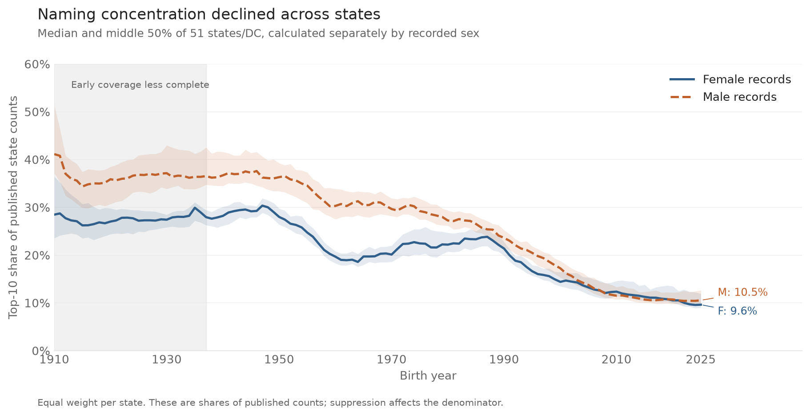
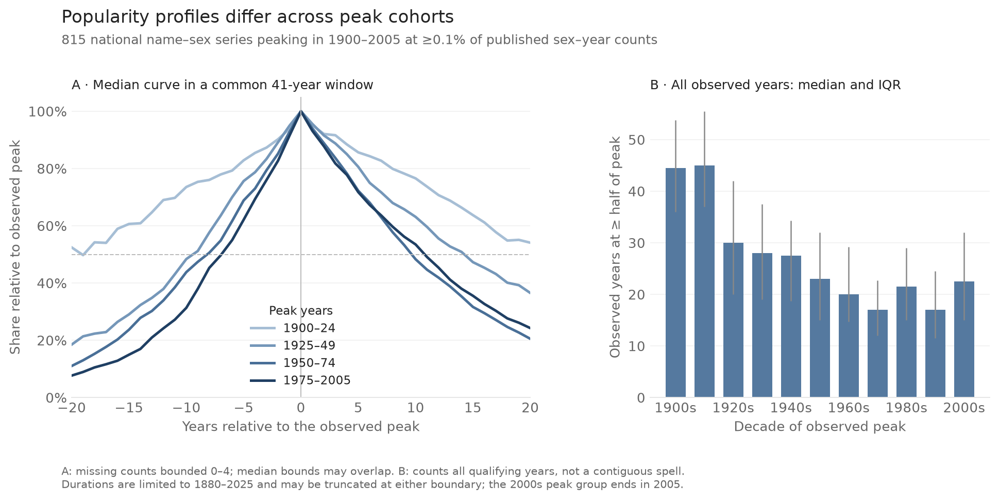
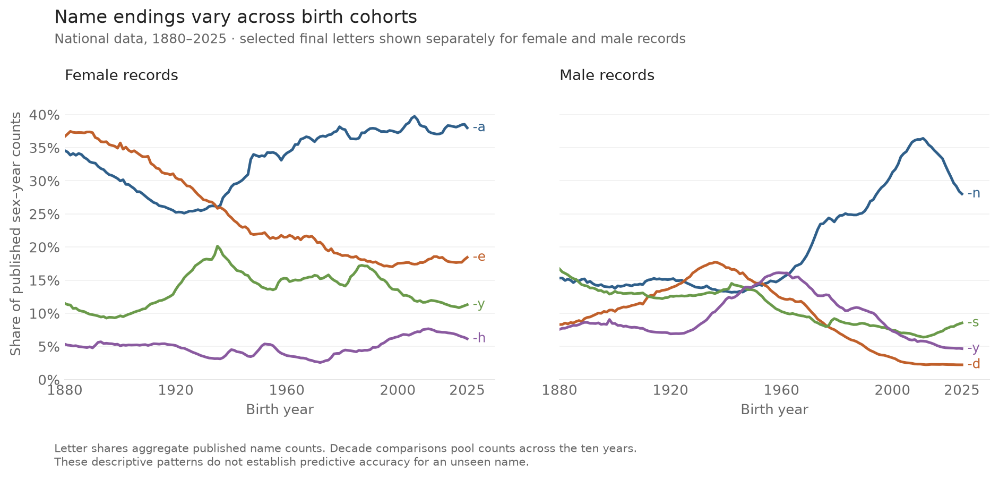
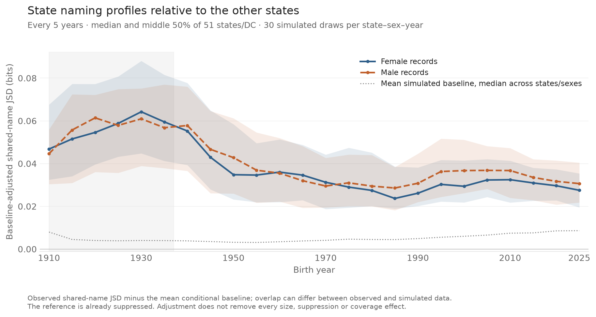
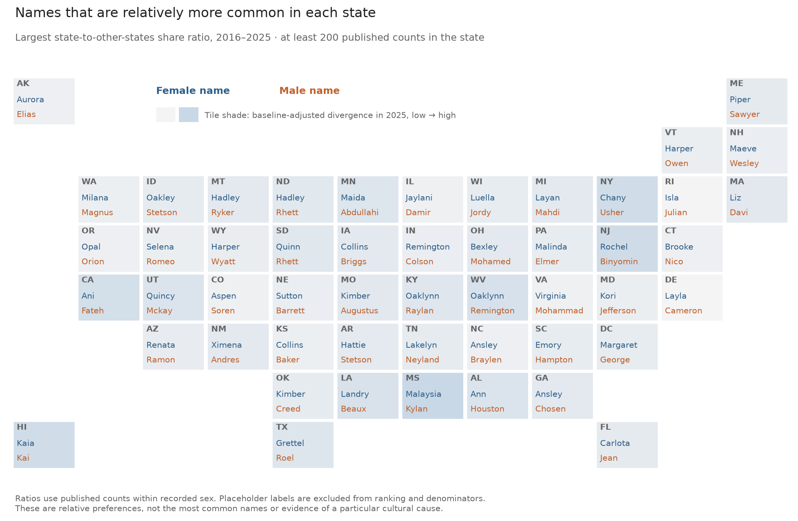
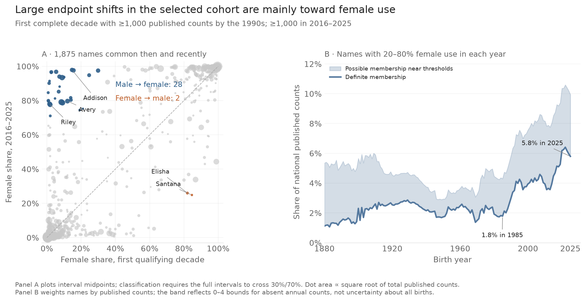
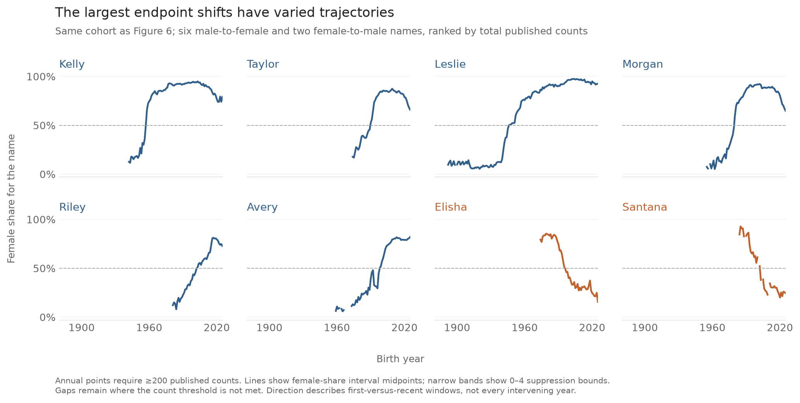

# Introduction

## Goals and research questions

We study how naming preferences change across generations and places,
and assess the limits of using a name as a demographic proxy. Three questions
organise the analysis.

1. Do names follow identifiable popularity life cycles, and does spelling
   help explain when they were popular?
2. Do states have distinctive naming profiles, and have those profiles
   become more similar over time?
3. How stable are name–sex associations, and can earlier spelling and
   popularity information help anticipate later changes?

These questions concern aggregate associations. A name cannot establish an
individual's sex or gender, and the data do not identify why parents chose it.

## Analytical scope

The study uses two complementary geographical levels: national series from
1880 and state series from 1910, both ending in 2025. The national series
provide an aggregate reference, while the state series allow us to examine
geographical differences. Comparisons between the datasets use their shared
1910–2025 period and matching recorded-sex categories.

This update presents preparation and exploratory evidence for each question.
National data support the analysis of life cycles, spelling and name–sex
associations; state data support geographical comparisons. Predictive models
remain a subsequent step: descriptive patterns alone do not demonstrate
out-of-sample predictive performance.

# Data

## Sources and observation unit

The data are drawn from the US Social Security Administration's
[national](https://www.ssa.gov/oact/babynames/names.zip) and
[state](https://www.ssa.gov/oact/babynames/state/namesbystate.zip) baby-name
datasets. The national data comprise 146 annual `yobYYYY.txt` files for
1880–2025. Each row gives a name × recorded sex × birth year count, with the
year obtained from the filename. The state data comprise 51 files for the
50 states and DC over 1910–2025; each observation additionally identifies
the state of birth.

Rows are aggregate counts, not individual births or independent survey
responses. National and state observations describe overlapping populations
at different geographical levels, so they are analysed in distinct tables.

SSA derives its name statistics from Social Security card applications.
Historical coverage is incomplete, particularly before 1937. The agency also
notes possible recording errors and treats different spellings separately.
Consequently, these data should not be described as a complete birth census.
See the [SSA background and qualifications](https://www.ssa.gov/oact/babynames/background.html).

The national documentation describes records as of 1 March 2026. Exact release
alignment between the national and state datasets has not been established;
comparisons of their published totals are therefore interpreted descriptively.

| Variable | Meaning | Type |
|---|---|---|
| `state` | State abbreviation, including DC; state table only | Categorical |
| `sex` | Recorded `F` or `M` category | Categorical |
| `year` | Birth year; derived from filename for national data | Integer, temporal |
| `name` | Published first-name spelling | Text |
| `count` | Published count for that combination | Positive integer |

## Data wrangling and preprocessing

Both datasets follow the same preparation procedure:

1. Read the source files with explicit column types, preserving published
   name strings and checking blank values separately. Extract the national
   birth year from each filename.
2. Inspect missing values, duplicate records, recorded-sex categories, years
   and counts to identify potential data issues.
3. Derive decade, name length, published popularity share and rank. Compute
   national measures within sex–year groups and state measures within
   state–sex–year groups.
4. Save the prepared national and state tables for analysis.

Preparation retains all **2,181,032 national records** and **6,696,687 state
records**. Inspection found no missing fields or duplicate keys. The data
contain **292 national sex–year groups** and **11,832 state–sex–year groups**. Placeholder-like labels occur in 655 national records and 1,811
state records. These observations are retained because a label alone does
not establish a recording error. No rows are removed or imputed.

The four derived features have explicit analytical roles:

| Derived field | Transformation | Purpose |
|---|---|---|
| `decade` | Round birth year down to the decade | Compare historical periods |
| `name_length` | Number of characters in the published spelling | Describe spelling patterns |
| `published_share` | Count ÷ total published count in the relevant geography–sex–year group | Compare relative popularity across different-sized groups |
| `rank` | Descending count within the group; alphabetical tie-break | Identify leading names and top-ten concentration |

The prepared national and state tables contain eight and nine columns,
respectively. They combine numerical measures (`count`, `name_length`,
`published_share`, `rank`), categorical fields (`sex` and, for state data,
`state`), temporal fields (`year`, `decade`) and text (`name`). Derived
variables serve the research questions without adding independent source
information; the number of aggregate records alone does not establish
statistical significance.

The EDA aggregates national records into name trajectories and spelling
profiles, and state records into geographical distributions. Female and male
counts are pivoted by name and year. Under the publication-threshold
assumption, an absent count is represented by a 0–4 interval rather than an
observed zero. Analysis-specific filters are stated with each result;
placeholder labels are excluded from distinctive-name rankings only.

The published counts sum to 375,362,447 nationally and 330,978,761 across
states over their respective periods. For the shared 1910–2025 period,
pooled-state totals range from 80.8% to 96.4% of national totals within
sex–year groups. These ratios describe the published datasets, not the
fraction of births covered.

## Challenges and interpretation rules

The SSA suppresses rare entries for privacy, so an absent record cannot be
assumed to represent zero births. Suppression also means that adding state
counts does not necessarily reproduce a national count.
[SSA publication limits](https://www.ssa.gov/oact/babynames/limits.html)
and [data qualifications](https://www.ssa.gov/oact/babynames/background.html)
describe these restrictions.

Popularity shares use published counts within the stated geography, year and
recorded-sex group as their denominator. They are not shares of all births.
Female share instead compares F with F + M for the same name and time window.
Where an opposite-sex record is absent, we do not automatically assign a
female share of 0 or 1.
The eligibility rules for each name–sex comparison are stated alongside
its results.

# Exploratory Data Analysis (EDA)

## Summary statistics and concentration

| Year | Sex | Published counts | Distinct names | Median top-10 share |
|---|---|---:|---:|---:|
| 1950 | F | 1,610,017 | 2,112 | 28.0% |
| 1950 | M | 1,720,112 | 1,721 | 36.3% |
| 1980 | F | 1,462,212 | 3,685 | 22.2% |
| 1980 | M | 1,668,069 | 2,502 | 27.2% |
| 2025 | F | 1,303,470 | 5,349 | 9.6% |
| 2025 | M | 1,466,284 | 4,368 | 10.5% |

Counts sum published state records; distinct names are the union of spellings
within each year and sex. The top-ten statistic gives each state/DC equal weight.

The ten leading names account for a substantially smaller share of published
counts in 2025 than in 1950: 9.6% versus 28.0% for female records, and 10.5%
versus 36.3% for male records in the median state. Female concentration has a
local low in 1964 within the 1950–1970 interval. Since 2003, the female and
male medians have remained within one percentage point of each other.

{#fig-concentration fig-alt="Female and male top-ten concentration declines over time, reaching approximately ten percent in 2025."}

This supports diversification among published names. It does not, by itself,
show whether states prefer the same names or whether name–sex associations
have changed. The following comparisons address those questions directly.

## RQ1: popularity life cycles and spelling

**Popular names show narrower periods of high popularity in later peak
cohorts.** We select 815 national name–sex series whose highest published
share occurs between 1900 and 2005 and reaches at least 0.1% of the relevant
sex–year total. Each trajectory is divided by its own peak share and aligned
on the peak year. Curves use a common window of 20 years before and after
the peak, so each cohort contains the same names throughout. The alignment
places each maximum at the centre by construction; it does not establish
that every name follows a single rise-and-fall cycle.

The median number of observed years at or above half of peak share is 44.5
for names peaking in the 1900s and 45 for those peaking in the 1910s. The
corresponding decade medians range from 17 to 23 for peaks from 1950 to 2005
(@fig-life-cycles). The measure counts all qualifying years, including any
separate periods of renewed popularity; it is not necessarily the length of
one continuous rise-and-fall cycle.

{#fig-life-cycles fig-alt="Median peak-aligned trajectories are narrower in later cohorts; decade medians of years near the peak decline from about 45 to 17–23."}

The observed pattern is consistent with faster turnover among these selected
popular names. Observation boundaries shorten some durations: early names may
already have been popular before 1880, and recent names may remain popular
after 2025. The bars count qualifying years over the full 1880–2025 record,
so their observation periods differ even though the plotted curves share
a common window.
Consequently, this comparison does not establish that every name's life cycle
has halved or that today's newly popular names will follow the same path.

**Spelling is associated with popularity period.** Pooling published counts
within each decade, the male share assigned to names ending in “n” rises from 13% in the
1940s to 34% in the 2000s, while “d” endings fall from 16% to 3%. For female
counts, “a” endings rise from 31% to 39% and “h” endings from 4% to 7%; “e”
endings decline (@fig-endings).

{#fig-endings fig-alt="Final-letter shares change over time, including a strong rise in male names ending in n and a decline in d endings."}

These changes make spelling a plausible predictor of a name's aggregate
popularity period. They do not measure how accurately spelling predicts that
period for unseen names. The association motivates character-based regression,
while the trajectory shapes motivate clustering.

## RQ2: state naming profiles and convergence

**The state distributions become more similar under a descriptive comparison.**
Every five years, we calculate Jensen–Shannon divergence between each
state's name distribution and the pooled other states, separately by recorded
sex. The comparison uses names published in both distributions, renormalised
to sum to one. Lower divergence means more similar relative frequencies on
that shared set of names.

We benchmark each comparison against 30 simulated draws from the pooled
other-state distribution, using the focal state's published total as the
draw size and suppressing simulated counts below five. Draws without any
published shared name have undefined divergence and are excluded.
Subtracting the mean simulated divergence gives a baseline-adjusted measure (@fig-divergence).
This is a descriptive benchmark, not a complete correction: the reference is
itself suppressed, observed and simulated shared vocabularies can differ,
and published totals are smaller than the underlying populations.

{#fig-divergence fig-alt="Baseline-adjusted state divergence declines between 1930 and 1985, followed by a smaller rise and broadly stable values."}

The median across state–sex groups falls from approximately 0.062 bits in
1930 to 0.025 in 1985, a reduction of about 60%, and is about 0.029 in 2025.
This is consistent with convergence in the published naming profiles during
the middle of the twentieth century. Starting in 1940 instead gives a decline
from 0.057 to 0.025 bits by 1985 (56%). Incomplete coverage before 1937 and
changing publication support limit the historical comparison; the benchmark
does not establish that residual differences are independent of state size.

**States also differ in which names are over-represented.** For 2016–2025,
we divide each name's share in a state by its share in the pooled other
states, within recorded-sex categories. Candidates must have at least 200
published counts in the focal state and a positive count elsewhere.
Placeholder labels are excluded from this ranking and its denominators.
The selected names have a median ratio of about 4.3 (@fig-map).

{#fig-map fig-alt="A state tile map gives one female and one male name per state, selected by relative over-representation."}

Examples include Abdullahi in Minnesota, Rochel and Binyomin in New Jersey,
Kai and Kaia in Hawaii, and Landry and Beaux in Louisiana. These are local
relative preferences, not necessarily the state's most common names.
Linguistic traditions, community composition and regional culture are possible
explanations, but the data contain no ethnicity, religion or parental-motive
variables with which to establish them. Suppression and the fixed minimum
count also affect rankings, particularly in small states.

## RQ3: stability of name–sex associations

**Most eligible names retain a strong association with one recorded-sex
category; large endpoint shifts are more often toward female use.** We compare
each name's first complete calendar decade with at least 1,000 published
counts, occurring no later than the 1990s, with 2016–2025. Names must also
reach 1,000 published counts in the recent window. This selects historically
common names that remain common, rather than all names ever recorded.

For each period, missing annual sex-specific counts are bounded at 0–4 before
calculating lower and upper female shares. A shift qualifies only if the
whole interval moves from below 30% to above 70%, or the reverse. This avoids
classifying a suppressed opposite-sex count as an observed zero.

{#fig-switch fig-alt="Most eligible names retain their recorded-sex association; shifts toward female use are more frequent. The second panel tracks names with female shares between 20 and 80 percent."}

Among 1,875 eligible names, 1,723 (91.9%) remain predominantly associated with
the same category at both endpoints. Twenty-eight shift from predominantly male
to predominantly female use and two shift in the reverse direction. This directional imbalance
is evidence about this selected cohort, not a
universal rule or an estimated probability that any new name will switch.
Names that declined below the recent threshold are excluded, so the comparison
cannot establish the prevalence of switching among all historical names.

The share of published counts assigned to names with female shares between
20% and 80% lies between 1.8% and 4.3% in 1985, versus 5.8%–9.9% in 2025.
The lower limit counts names whose full female-share interval is inside the
20%–80% range; the upper limit also counts names whose interval overlaps it.
Rare names widen these bounds, but the 2025 lower limit still exceeds the
1985 upper limit. Shared name use has therefore increased under this
definition even after allowing for threshold suppression. This describes
aggregate usage, not an individual's identity.

{#fig-switchers fig-alt="Eight trajectories show how the selected names changed their female share; selection uses the same cohort as the preceding figure."}

Selection ranks names by total published counts over 1880–2025. Trajectories
show only years with at least 200 published counts; lines are interval
midpoints and shading shows the suppression bounds.

The selected male-to-female examples are Kelly, Taylor, Leslie, Morgan, Riley
and Avery; the reverse examples are Elisha and Santana. Their trajectories
show that endpoint changes can conceal reversals or periods of mixed use.
A shift need not be permanent or follow one common timetable.
Their shapes motivate using past popularity and share changes as predictors;
prospective performance still requires evaluation on later periods.

# Analysis

## Preliminary findings and interpretation

The completed analysis gives a first answer to each question. For RQ1,
later peak cohorts spend fewer observed years near peak popularity, and
spelling patterns change across eras. For RQ2, shared-name distributions
become more similar over much of the twentieth century while retaining local
relative preferences. For RQ3, the selected common-name cohort shows a marked
directional imbalance in large association shifts.

These findings are descriptive. Peak-based selection, continued-popularity
requirements, suppression and changing historical coverage all affect which
names can be compared. The state benchmark is conditional on published data;
it does not isolate cultural effects. None of the analyses establishes
individual characteristics from a name or the causes of parental choices.

## Next analytical steps

The following models have not yet been fitted:

- **Trajectory clustering:** group national name–sex series by normalised
  popularity shape over common windows. Compare cluster solutions across
  periods and minimum-count rules, accounting for truncated trajectories.
- **Spelling-based regression:** use character n-grams to predict a name's
  count-weighted mean birth year. Compare held-out mean absolute error with
  a training-mean baseline and a final-letter baseline. Keep each spelling
  in one split; the target is an aggregate popularity period.
- **State similarity:** build state–decade name profiles and compare states
  on a common vocabulary. Pairwise profile distances are needed for
  clustering; a state's divergence from a pooled reference is not itself
  a pairwise distance matrix. Compare results across vocabulary and
  suppression choices before interpreting regional groupings.
- **Name–sex shift prediction:** define outcomes over fixed future windows
  and use only earlier spelling and trajectory features. Compare
  precision–recall performance with majority-class and persistence
  baselines; accuracy alone can be misleading when shifts are rare.

Preprocessing and feature selection will be fitted on training data only.
Name-grouped splits address unseen spellings; forward-time splits address
future changes. These are separate prediction questions. Period, count and
share thresholds will be varied to assess whether conclusions depend on the
chosen definitions.

# Conclusion

The national and state datasets show that American naming preferences vary
across generations, places and recorded-sex categories. Popular-name cohorts
have shorter observed high-popularity periods in later decades, and final
letters carry information about popularity era. State profiles show
convergence under the chosen measure while retaining distinctive local
names. Among historically common names that remain common, large shifts
are more frequent toward female use.

The results answer the descriptive parts of the research questions and
provide a basis for the next stage. Clustering and prediction will determine
whether these patterns form reproducible groups and whether earlier
information predicts outcomes beyond simple baselines.

# References {.unnumbered}

- US Social Security Administration.
  [Beyond the Top 1000 Names](https://www.ssa.gov/oact/babynames/limits.html).
  Publication restrictions and links to official downloadable archives.
  Accessed 16 November 2026.
- US Social Security Administration.
  [Background information for popular names](https://www.ssa.gov/oact/babynames/background.html).
  Source population, coverage and data qualifications. Accessed 16 November 2026.
- US Social Security Administration.
  *National Data on the relative frequency of given names in the population of
  U.S. births where the individual has a Social Security Number*.
  National dataset documentation (`NationalReadMe.pdf`), records as of
  1 March 2026.
- Elwin Freudiger.
  [Course project template](https://github.com/Elwin-Freudiger/project-template).
  Report structure and Quarto formatting, adapted for this update.
  Accessed 11 November 2026.

# Reproducibility {.unnumbered}

Run `notebooks/01_state_preparation.ipynb`, then `notebooks/02_state_eda.ipynb`
with Python 3.12 and the dependencies in `requirements.txt`. The EDA notebook
contains the methods, code and results; it saves seven figures in
`reports/figures/` and numerical outputs in `reports/tables/`.
Simulations use seed 2026. Render with `quarto render reports/update_AJ.qmd`;
the HTML embeds its figures.
